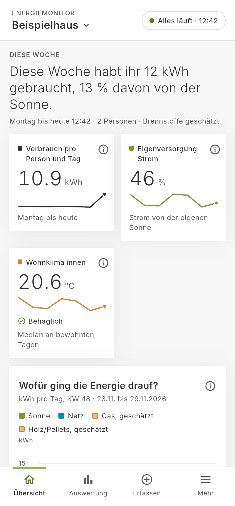
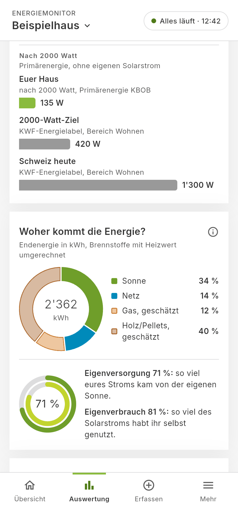
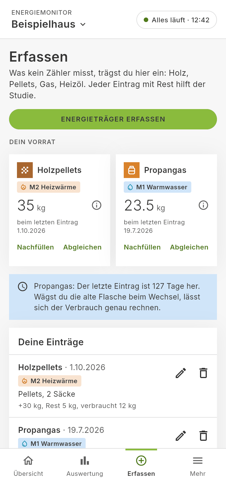
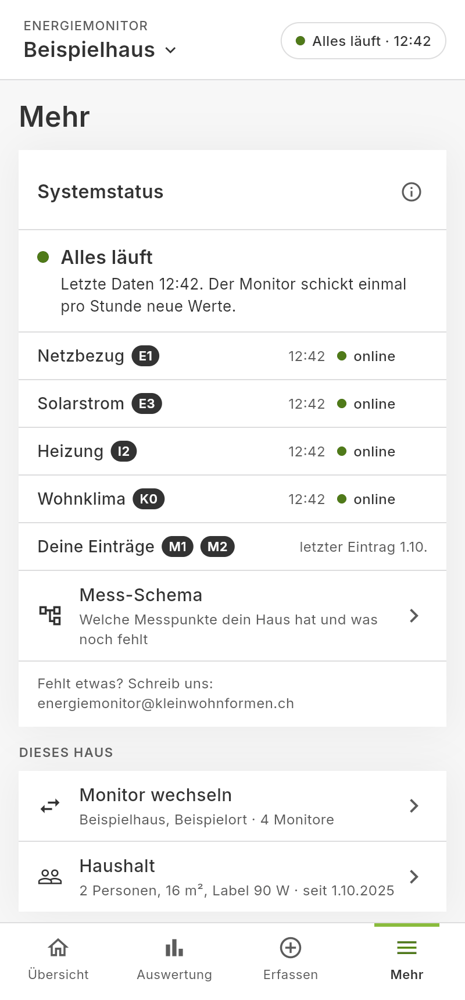

# KWF Energiemonitor

**Wir messen, was kleine Häuser wirklich brauchen.**

Der Energiemonitor ist ein offenes Messsystem für Kleinwohnformen (Tiny Houses, Wohnwagen, Kleinhäuser). Er misst Strom (230 V und Gleichstrom), Wärmeträger, Wohnklima und Wasser und zeigt die Kurven in einer App. Gebaut wurde er für die Energiestudie mit der HSLU und für den [Verein Kleinwohnformen (KWF)](https://kleinwohnformen.ch), unter anderem um das KWF-Energielabel zu validieren.

Der Energiemonitor ist **kein Produkt**. Der Verein verkauft und liefert ihn nicht und gibt keine Support-Zusagen. Es ist eine offene Plattform zum Nachbauen und Mitmachen.

> **Status:** Zwei Monitore laufen im Langzeittest (Tiny House mit 99.7 % Verfügbarkeit von April bis September 2026, dazu ein Objekt mit Victron 48 V). Seit November 2026 rechnet die Cloud jede Stunde Tageswerte, und die App zeigt Übersicht und Auswertung. Die Hauptstudie ist in Planung.

## Ich will einen Monitor bauen

1. **[Bauanleitung](docs/bauanleitung.md)**: von der Einkaufsliste bis zu den Kurven in der App. Rechne mit 6 bis 8 Stunden pro Monitor, wenn du die Technik schon kennst.
2. **[Sicherheit](docs/sicherheit.md)**: eigene Passwörter und Schlüssel setzen. Das ist ein Pflichtschritt, bevor das Gerät online geht.
3. **[Variablen](docs/variablen.md)**: alle Balena-Variablen im Überblick.

Voraussetzungen: Du kennst einen Raspberry Pi, hast schon einmal Node-RED gesehen und löst Aufgaben im Terminal.

## So sieht die App aus

Die App läuft im Browser und auf dem Handy (als Web-App installierbar). Die Bilder zeigen ein Beispielhaus mit Demodaten.

| Übersicht | Auswertung | Erfassen | Mehr |
|---|---|---|---|
|  |  |  |  |
| Wie viel Energie die Woche gebraucht hat, wie viel davon von der eigenen Sonne kam, wie behaglich es war | Watt pro Person, Herkunft der Energie, Monat für Monat, Heizen und Wohnklima über Woche, Monat, Saison oder Jahr | Holz, Pellets, Gas und Heizöl eintragen, die kein Zähler misst. Die App führt den Vorrat | Kommen die Daten an? Messpunkte, Mess-Schema, Haushalt, Download als XLSX |

## Zwei Betriebsvarianten

| | **A: Mitmachen im KWF-System** | **B: Komplett selbst hosten** |
|---|---|---|
| Wohin gehen die Daten? | In die KWF-Cloud und die [KWF-App](https://energiemonitor-kwf.web.app/) | In deine eigene Google-Cloud- und Firebase-Umgebung |
| Fliessen die Daten in die Energiestudie? | Ja | Nein |
| Was brauchst du vom Team? | Einen Device-Key und einen App-Zugang, Kontakt: [energiemonitor@kleinwohnformen.ch](mailto:energiemonitor@kleinwohnformen.ch) | Nichts |
| Anleitung | [Variante A](docs/variante-a-mitmachen.md) | [Variante B](docs/variante-b-selbst-hosten.md) |

Wenn du einen Monitor für die Energiestudie baust, wähle **Variante A**. Das Team besteht aus Freiwilligen, die Freischaltung kann deshalb etwas dauern.

## Wie das System aufgebaut ist

Sensoren liefern Messwerte an eine Edgebox mit BalenaOS. Dort puffert Node-RED die Daten und schickt sie an eine Cloud-API, die sie in Firestore speichert. Die App liest aus Firestore. Details und ein Bild: [Architektur](docs/architektur.md).

Die Messpunkte (E1, E2, I1, K0 usw.) sind in einem [Glossar](docs/messpunkte.md) definiert. Das Glossar ist die einzige Quelle, die anderen Repos verlinken darauf.

Forschungs- und Entwicklungsnotizen: [mioty-Basisstation und Sentinum Apollon (Wassertank D1)](docs/rnd-mioty-apollon.md).

## Die Repos

| Repo | Rolle | Status |
|---|---|---|
| [energiemonitor-balena-nodered](https://github.com/Verein-Kleinwohnformen/energiemonitor-balena-nodered) | Container für die Edgebox: Node-RED, MQTT-Broker, BLE-Scanner | produktiv im Langzeittest |
| [kwf-energiemonitor-db](https://github.com/Verein-Kleinwohnformen/kwf-energiemonitor-db) | Node-RED-Connector (puffert Messwerte, sendet an die API), npm-Paket | Beta |
| [energiemonitor-api](https://github.com/Verein-Kleinwohnformen/energiemonitor-api) | Cloud-API (Cloud Run) und XLSX-Export | produktiv im Langzeittest |
| [energiemonitor-app](https://github.com/Verein-Kleinwohnformen/energiemonitor-app) | Flutter-Web-App | produktiv im Langzeittest |
| [energiemonitor-nodered-flows](https://github.com/Verein-Kleinwohnformen/energiemonitor-nodered-flows) | Alte Beispiel-Flows, dazu die Flows der Testgeräte (ein Branch pro Gerät) | veraltet, nur als Vorlage |

Ältere Repos aus der Zeit vor 2024 (Azure-Prototyp, erste Hardware, Gehäuse) sind archiviert und werden nicht mehr gepflegt.

## Mitmachen

Fragen, Fehler und neue Sensoren melden: siehe [CONTRIBUTING](CONTRIBUTING.md). Sicherheitslücken bitte nicht öffentlich, sondern gemäss [SECURITY](SECURITY.md) melden. Kontakt: [energiemonitor@kleinwohnformen.ch](mailto:energiemonitor@kleinwohnformen.ch).

## Lizenz

Apache License 2.0, siehe [LICENSE](LICENSE).
