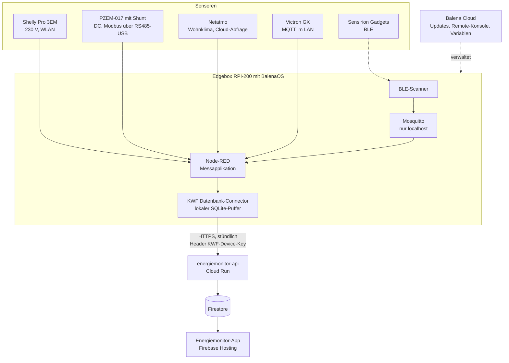

# Architektur

Der Energiemonitor ist ein Baukasten. Jede Kleinwohnform hat andere Energiesysteme, deshalb entsteht pro Objekt ein eigenes Messschema und die Sensoren werden passend kombiniert.



## Bausteine

- **Edgebox:** Seeed Edgebox RPI-200 (Raspberry Pi CM4) mit BalenaOS. Alternativ funktioniert für Selbstbauer ein Raspberry Pi 4. Verbindung über LTE oder Ethernet.
- **Node-RED:** liest die Sensoren aus, aggregiert (Shelly und Victron: Abfrage jede Sekunde, Mittelwert über 10 s) und gibt die Werte an den Connector weiter.
- **Connector** ([kwf-energiemonitor-db](https://github.com/Verein-Kleinwohnformen/kwf-energiemonitor-db)): speichert alle Messwerte lokal in SQLite und sendet sie im Intervall (Standard 1 Stunde) an die API, auch nachträglich nach einem Verbindungsunterbruch.
- **MQTT-Broker:** Mosquitto läuft nur auf dem Gerät selbst (`127.0.0.1`) und nimmt die Werte des BLE-Scanners entgegen.
- **API** ([energiemonitor-api](https://github.com/Verein-Kleinwohnformen/energiemonitor-api)): Flask auf Google Cloud Run. Authentifizierung über den Header `KWF-Device-Key`. Die Schlüssel liegen im Secret Manager.
- **Firestore:** speichert Telemetrie, Messpunkt-Metadaten, manuelle Einträge und Benutzerrechte.
- **App** ([energiemonitor-app](https://github.com/Verein-Kleinwohnformen/energiemonitor-app)): Flutter Web mit Firebase Auth. Zeigt Messpunkte, Diagramme und erlaubt den XLSX-Export (maximal 31 Tage).
- **Balena Cloud:** Geräteverwaltung, Updates, Variablen und Remote-Konsole. Gratis bis 10 Geräte.

## Datenformat

Seit Connector v0.4 gibt es keine Topics mehr. Alles steckt in `msg.payload`:

```json
{
  "values": { "voltage": 231.27, "act_power": 14.555, "pf": 0.33, "aprt_power": 44.35 },
  "sensor_id": "shelly-3em-pro",
  "timestamp": 1760084970005,
  "metering_point": "E1"
}
```

Zeitstempel sind Millisekunden (UTC). Einzelne Werte können einen eigenen Zeitstempel mit dem Präfix `ts_` tragen. Ausführlich im [Connector-Repo](https://github.com/Verein-Kleinwohnformen/kwf-energiemonitor-db).

## Firestore-Struktur

```
/devices/{device_id}/telemetry/{year}/{month}/{uuid}   Batch-Dokument, bis 2000 Datenpunkte
/devices/{device_id}/metering_points/{mp}              Sensortypen, first_seen, last_seen, Wertfelder
/devices/{device_id}/manual/{year}/data/{entry}        manuelle Einträge aus der App
/monitors/{monitorId}                                  Monitor-Stammdaten
/users/{uid}                                           monitor_read[], monitor_edit[]
```

Die Telemetrie wird ausschliesslich über die API geschrieben. Lesen und Schreiben in der App ist über die Firestore-Rules an `monitor_read` und `monitor_edit` gebunden.

## Bekannte Grenzen

- Der Export ist auf **31 Tage** begrenzt und schneidet nach UTC-Tagen. Eine XLSX-Datei kann über 30 MB pro Monat gross werden.
- Aggregation und Plausibilitätschecks laufen heute in den Node-RED-Flows, nicht im Connector.
- Netatmo ist von der Netatmo-Cloud abhängig. Alternative im Kit: Sensirion BLE.
