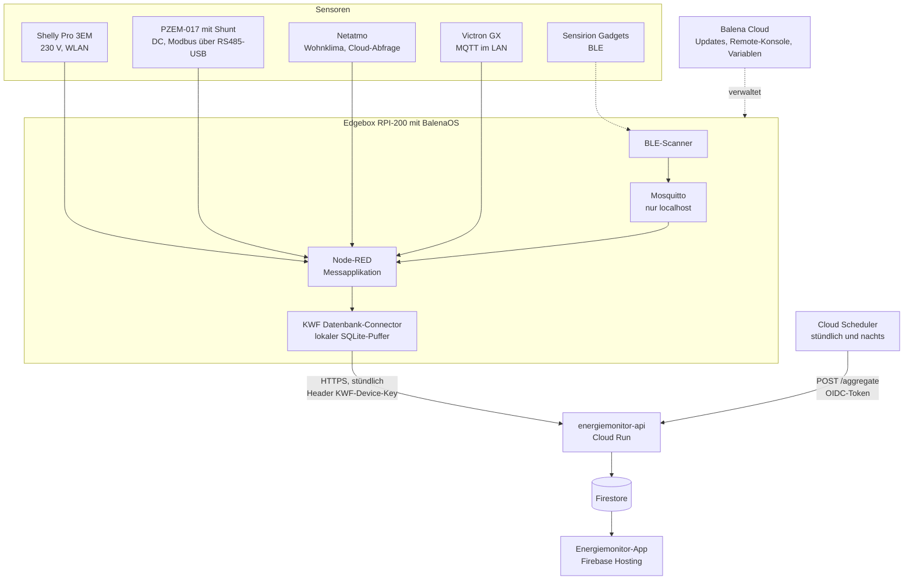

# Architektur

Der Energiemonitor ist ein Baukasten. Jede Kleinwohnform hat andere Energiesysteme, deshalb entsteht pro Objekt ein eigenes Messschema und die Sensoren werden passend kombiniert.



## Bausteine

- **Edgebox:** Seeed Edgebox RPI-200 (Raspberry Pi CM4) mit BalenaOS. Alternativ funktioniert für Selbstbauer ein Raspberry Pi 4. Verbindung über LTE oder Ethernet.
- **Node-RED:** liest die Sensoren aus, aggregiert (Shelly und Victron: Abfrage jede Sekunde, Mittelwert über 10 s) und gibt die Werte an den Connector weiter.
- **Connector** ([kwf-energiemonitor-db](https://github.com/Verein-Kleinwohnformen/kwf-energiemonitor-db)): speichert alle Messwerte lokal in SQLite und sendet sie im Intervall (Standard 1 Stunde) an die API, auch nachträglich nach einem Verbindungsunterbruch.
- **MQTT-Broker:** Mosquitto läuft nur auf dem Gerät selbst (`127.0.0.1`) und nimmt die Werte des BLE-Scanners entgegen.
- **API** ([energiemonitor-api](https://github.com/Verein-Kleinwohnformen/energiemonitor-api)): Flask auf Google Cloud Run. Die Geräte melden sich mit dem Header `KWF-Device-Key` an, die Schlüssel liegen im Secret Manager. Dazu rechnet die API aus den Rohdaten **Tageswerte** (Strom nach Herkunft, Heizen, Wohnklima, bewohnte Tage, Brennstoffe). Diesen Endpunkt `/aggregate` darf nur Cloud Scheduler aufrufen (stündlich für heute, nachts für die letzten drei Tage).
- **Firestore:** speichert Telemetrie, Tageswerte, Messpunkt-Metadaten, manuelle Einträge, Haushalt, Faktoren und Benutzerrechte.
- **App** ([energiemonitor-app](https://github.com/Verein-Kleinwohnformen/energiemonitor-app)): Flutter-Web-App mit Firebase Auth und vier Bereichen: Übersicht, Auswertung, Erfassen (Brennstoffe ohne Zähler) und Mehr (Systemstatus, Haushalt, Mess-Schema, XLSX-Export). Übersicht und Auswertung lesen nur die Tageswerte, nie Rohdaten. Bilder: siehe [README](../README.md#so-sieht-die-app-aus).
- **Balena Cloud:** Geräteverwaltung, Updates, Variablen und Remote-Konsole. Gratis bis 10 Geräte.

## Datenformat

Seit Connector v0.4 gibt es keine Topics mehr. Alles steckt in `msg.payload`:

```json
{
  "values": { "voltage": 231.27, "act_power": 14.555, "pf": 0.33, "aprt_power": 44.35 },
  "sensor_id": "shelly-3em-pro",
  "timestamp": 1760084970005,
  "metering_point": "E1"
}
```

Zeitstempel sind Millisekunden (UTC). Einzelne Werte können einen eigenen Zeitstempel mit dem Präfix `ts_` tragen. Ausführlich im [Connector-Repo](https://github.com/Verein-Kleinwohnformen/kwf-energiemonitor-db).

## Firestore-Struktur

```
/devices/{device_id}                                   Platzhalter (device_id, note, created_at)
/devices/{device_id}/telemetry/{year}                  Platzhalter pro Jahr
/devices/{device_id}/telemetry/{year}/{month}/{uuid}   Batch-Dokument, bis 2000 Datenpunkte
/devices/{device_id}/metering_points/{mp}              Sensortypen, first_seen, last_seen, Wertfelder, Datenqualität
/devices/{device_id}/daily/{YYYY-MM-DD}                Tageswerte (Lokalzeit), von der API gerechnet
/devices/{device_id}/aggregation/{doc}                 Stand der Brennstoff-Verteilung, nur Backend
/devices/{device_id}/manual/{year}/data/{entry}        manuelle Einträge aus der App
/monitors/{monitorId}                                  Monitor-Stammdaten, Studienmodus
/monitors/{monitorId}/household/{entry}                Personen, Wohnfläche, Label-Wert, mit "gültig ab"
/config/factors                                        Heizwerte, Primärenergie- und Gewichtungsfaktoren
/users/{uid}                                           monitor_read[], monitor_edit[]
/admin_log/{entry}                                     Protokoll jeder Änderung an Zugriffen
```

Telemetrie und Tageswerte schreibt ausschliesslich die API. Lesen und Schreiben in der App ist über die [Firestore-Rules](https://github.com/Verein-Kleinwohnformen/energiemonitor-app/blob/main/firestore.rules) an `monitor_read` und `monitor_edit` gebunden. Es gibt keine Rolle, die alle Häuser sieht: Ein Superadmin (Custom Claim) verwaltet Zugriffe, sieht aber Messdaten nur mit eigenem Eintrag in `monitor_read`. Das Format der Tageswerte steht im App-Repo unter [`docs/konzept/04_datenmodell.md`](https://github.com/Verein-Kleinwohnformen/energiemonitor-app/blob/main/docs/konzept/04_datenmodell.md).

**Platzhalter-Dokumente:** Firestore legt Elterndokumente nicht selbst an. Ohne sie erscheinen `devices/{id}` und die Jahresdokumente in der Konsole kursiv (Geister-Dokumente), und `GET devices` liefert ohne `showMissing` nichts. Die Platzhalter für `emon01` und `emon03` wurden am 9. November 2026 einmalig angelegt: `devices/{id}`, `telemetry/{Jahr}` und `manual/{Jahr}` (nur Jahre mit Daten). Sie enthalten nur `device_id`, `note` und `created_at`. API und App lesen und schreiben sie nicht. Bei einem neuen Gerät oder Jahreswechsel fehlen sie wieder, bis die API sie anlegt (siehe [Backlog](../BACKLOG.md)). Die Messpunkte stehen unter `devices/{id}/metering_points`.

## Bekannte Grenzen

- Die API exportiert höchstens **31 Tage** pro Aufruf und schneidet nach UTC-Tagen. Längere Zeiträume holt die App als Monatsdateien. Eine XLSX-Datei kann über 30 MB pro Monat gross werden.
- Mittelwerte über 10 s und Plausibilitätschecks laufen in den Node-RED-Flows, nicht im Connector. Tageswerte rechnet die API.
- Netatmo ist von der Netatmo-Cloud abhängig. Alternative im Kit: Sensirion BLE.
